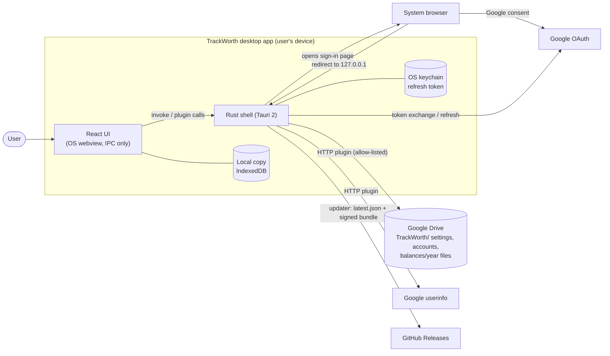

# Architecture

A one-page overview. The _why_ behind each choice is in the [ADRs](adr/README.md).

## System context



There is no TrackWorth server (ADR-0003). The webview has no direct network access. Every
request goes through Rust and is limited by `src-tauri/capabilities/`.

## Layers

```
UI (TypeScript, src/)
  features/   React screens + hooks per feature   ─┐
                                                   ├─► domain/   pure TS: schema, money, net worth
  services/   side effects (auth, drive, update)  ─┘
     │  invoke('auth_*'), plugin-http fetch, plugin-updater
     ▼
Native (Rust, src-tauri/src/)
  auth/       OAuth loopback + PKCE, keychain, token cache/refresh
  lib.rs      plugin registration (http, opener, process, updater) + commands
```

- **`domain/`** is pure and deterministic. It is the easiest place for agents to make correct
  changes, and it is unit-tested to 100%.
- **`services/`** is the only UI layer that touches Tauri or the network, with an injectable
  `fetch` for tests. `isDesktopApp()` keeps the UI usable in a plain browser for development and
  e2e tests.
- **Rust** is kept small: only what the webview can't or shouldn't do.

## Key flows

### First sign-in

1. The user clicks **Sign in with Google**, and the UI calls `invoke('auth_sign_in')`.
2. Rust binds `127.0.0.1:<random>`, creates a PKCE verifier and challenge plus `state`, and
   opens Google's consent page in the default browser.
3. Google redirects to the loopback address. Rust checks `state`, exchanges the code for tokens,
   checks the `drive.file` scope was granted, and saves the refresh token in the keychain.
4. Rust returns an access token. The UI fetches the profile (name) and shows it in the header.

### App start (already signed in)

`auth_restore` refreshes silently from the keychain. If Google rejects the refresh token
(`invalid_grant`), it is deleted and the sign-in screen is shown.

### Load and save

Storage is split across files (ADR-0014): `TrackWorth/settings.json` (settings and the period
of every balance file), `TrackWorth/accounts.json`, and `TrackWorth/balances/<year>.json` (one
per financial year, named by start year). `services/storage/dataStore.ts` does the work; the
rules live as pure functions in `domain/storage/`.

1. **Load:** list the `TrackWorth` and `balances` folders (one request each), which returns every
   file's Drive `version`. Files whose version matches the local copy (IndexedDB) are read from
   it; only changed files are downloaded. Each file is validated with Zod (newer versions are
   refused), then they're assembled into one in-memory dataset. A file only owns entries dated
   within the period `settings.json` records for it.
2. **First run / upgrade:** with no `settings.json`, an older single `trackworth-data.json` is
   migrated (v1/v2 → v3), written as split files, read back to verify, then moved to Drive's
   trash. Otherwise empty files are created.
3. **Save:** screens apply a pure change to the dataset (`useUpdateDataFile`). The store splits
   the result, compares it with what's stored, and writes only the files that changed: balance
   files that gain entries, then `accounts.json`, then `settings.json`, then balance files that
   gave entries away, then trashes unlisted files. An interrupted save therefore never shows
   missing or duplicated data.
4. **Stale devices:** every write re-checks that file's Drive `version`. On a mismatch it raises
   `conflict` and the UI offers a reload. It never overwrites blindly.
5. **Financial-year change:** the current year's file follows the new setting immediately, the
   previous file is shortened or lengthened to meet it, and older files are untouched.
6. **Offline (ADR-0015):** a request that gets no response at all (no connection, DNS, timeout),
   or a token refresh that can't reach Google, is reported as `offline`. Loading then falls back
   to the workspace (the data as last synced, kept in IndexedDB) and the header shows an
   "Offline" notice. The app retries when the connection returns and every 30 seconds. At start,
   if sign-in can't reach Google but this device has signed in before, the app opens in offline
   mode with the saved name. Saving offline is not possible yet (editing offline comes next).
7. Every request asks Rust for an access token (`auth_access_token`), which refreshes it shortly
   before expiry.

### Update (ADR-0007)

1. The owner merges the release-please PR. CI builds and signs installers and uploads them plus
   `latest.json` to GitHub Release `vX.Y.Z`.
2. The app checks `latest.json` on start and hourly. If the release is newer, a banner offers
   **Update and restart** or **Later**.
3. On confirm, the app downloads the bundle, verifies its signature, installs it and relaunches.

## Distribution

| Target                  | How                                                                       | ADR  |
| ----------------------- | ------------------------------------------------------------------------- | ---- |
| macOS / Windows / Linux | Installers on GitHub Releases, built by `release.yml` with `tauri-action` | 0008 |
| Android                 | Tauri 2 mobile (later)                                                    | 0009 |
