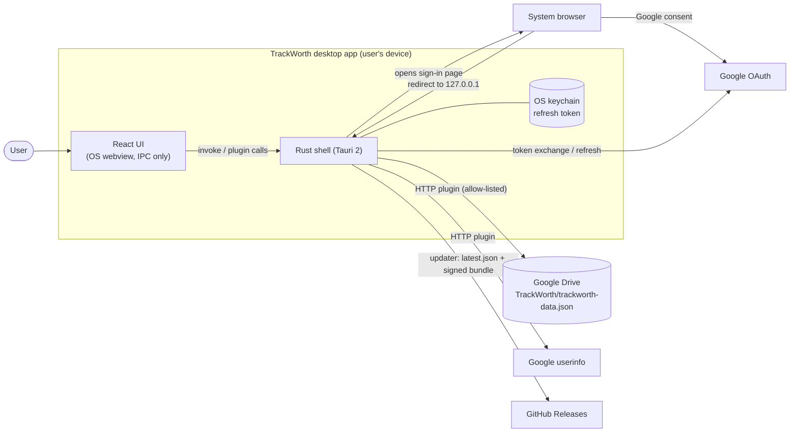

# Architecture

A one-page overview. The _why_ behind each choice is in the [ADRs](adr/README.md).

## System context



There is no TrackWorth server (ADR-0003). The webview has no direct network access. Every
request goes through Rust and is limited by `src-tauri/capabilities/`.

## Layers

```
UI (TypeScript, src/)
  features/   React screens + hooks per feature   ─┐
                                                   ├─► domain/   pure TS: schema, money, net worth
  services/   side effects (auth, drive, update)  ─┘
     │  invoke('auth_*'), plugin-http fetch, plugin-updater
     ▼
Native (Rust, src-tauri/src/)
  auth/       OAuth loopback + PKCE, keychain, token cache/refresh
  lib.rs      plugin registration (http, opener, process, updater) + commands
```

- **`domain/`** is pure and deterministic. It is the easiest place for agents to make correct
  changes, and it is unit-tested to 100%.
- **`services/`** is the only UI layer that touches Tauri or the network, with an injectable
  `fetch` for tests. `isDesktopApp()` keeps the UI usable in a plain browser for development and
  e2e tests.
- **Rust** is kept small: only what the webview can't or shouldn't do.

## Key flows

### First sign-in

1. The user clicks **Sign in with Google**, and the UI calls `invoke('auth_sign_in')`.
2. Rust binds `127.0.0.1:<random>`, creates a PKCE verifier and challenge plus `state`, and
   opens Google's consent page in the default browser.
3. Google redirects to the loopback address. Rust checks `state`, exchanges the code for tokens,
   checks the `drive.file` scope was granted, and saves the refresh token in the keychain.
4. Rust returns an access token. The UI fetches the profile (name) and shows it in the header.

### App start (already signed in)

`auth_restore` refreshes silently from the keychain. If Google rejects the refresh token
(`invalid_grant`), it is deleted and the sign-in screen is shown.

### Load and save

1. `driveClient.loadOrCreate()` finds `TrackWorth/` in My Drive, then `trackworth-data.json`,
   creating either one if missing, and records the Drive `version`.
2. `parseDataFile()` validates the file with Zod. It rejects newer schema versions and migrates
   older ones (ADR-0006).
3. Each save re-checks the Drive `version` first. On a mismatch it raises `conflict` and the UI
   offers a reload. It never overwrites blindly.
4. Every request asks Rust for an access token (`auth_access_token`), which refreshes it shortly
   before expiry.

### Update (ADR-0007)

1. The owner merges the release-please PR. CI builds and signs installers and uploads them plus
   `latest.json` to GitHub Release `vX.Y.Z`.
2. The app checks `latest.json` on start and hourly. If the release is newer, a banner offers
   **Update and restart** or **Later**.
3. On confirm, the app downloads the bundle, verifies its signature, installs it and relaunches.

## Distribution

| Target                  | How                                                                       | ADR  |
| ----------------------- | ------------------------------------------------------------------------- | ---- |
| macOS / Windows / Linux | Installers on GitHub Releases, built by `release.yml` with `tauri-action` | 0008 |
| Android                 | Tauri 2 mobile (later)                                                    | 0009 |
